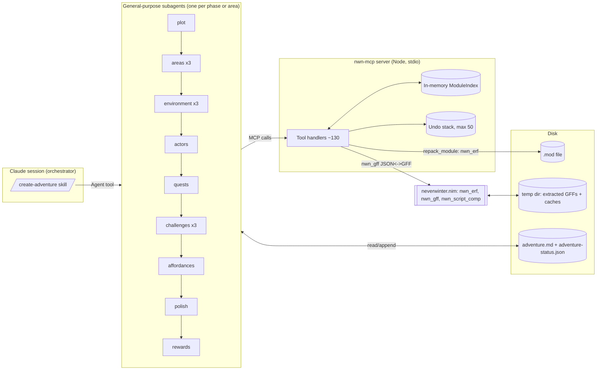
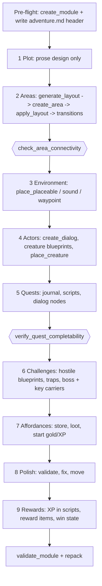
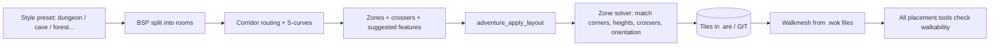
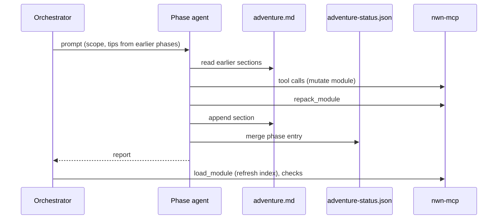
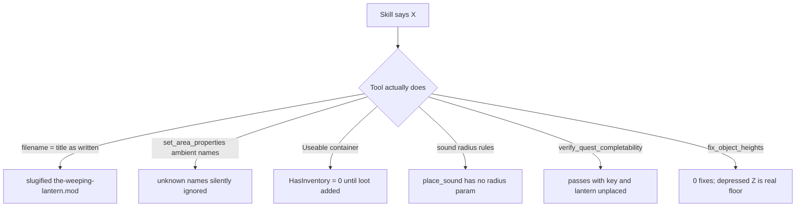

# How nwn-mcp worked: a live run building "The Weeping Lantern"

Run date: 2026-10-17, macOS arm64, NWN:EE (Steam), neverwinter.nim tools.
Result: 3 areas, 2 quests, 12 hand-made creature blueprints (25 placed creatures incl. ambient), 25 scripts, 3 custom items, 1 store. About 36 minutes wall-clock, 9 subagents-phases (15 agent calls). `validate_module`: 454 errors, all base-game script false positives; 0 actionable. Not play-tested.

## 1. The architecture in one picture

Key idea: the server is a stateful editor. `load_module` unpacks the .mod to a temp dir, converts every GFF to JSON, and builds an index. Tools mutate the JSON and write it back; `repack_module` rebuilds the .mod. The agents never touch module files directly, only `adventure.md` (shared memory between phases) and `adventure-status.json` (phase status).

## 2. The pipeline and what each phase actually did

| Phase | Main tools | Time (approx) | Notes |
|---|---|---|---|
| 1 Plot | list_tilesets, get_module_summary | 50 s | Pure writing; no tileset adjacency check |
| 2 Areas | adventure_generate_layout, adventure_apply_layout, create_area, adventure_create_transition | 4.5 min total | Heaviest tooling; most generator quirks |
| 3 Environment | place_placeable (75 calls), place_sound, place_waypoint | 7.5 min | Trial-and-error placement against the walkability check |
| 4 Actors | create_dialog, create_creature_blueprint, place_creature | 3.5 min | Index went stale |
| 5 Quests | create_journal, write_script x14, add_dialog_node | 3 min | Vault gated via dialog condition |
| 6 Challenges | create_creature_blueprint (inventory), place_creature, place_trigger | 3.5 min | Key/lantern carried by creatures |
| 7 Affordances | create_store_blueprint, add_items_to_container | 3.7 min | Containers had no inventory |
| 8 Polish | validate_module, move_object, fix_object_heights | 3.8 min | Found a real trap-script bug |
| 9 Rewards | edit_journal_quest, write_script, create_item_blueprint | 2.6 min | Possible double XP |

## 3. The strongest part: area generation

What this gets right: the server owns the tileset rules (corner terrains and crossers), so the LLM only chooses style, size and preferred features. All three areas came out connected on the first pass. Walkmesh-backed placement means objects get correct Z and are never inside walls.

What it costs: the layout JSON is large, the generator under-delivers (asked 5 crypt rooms, got 4; vault asked 2, got 1 merged chamber), and a 4x4 room can't satisfy the spacing rules, so combat and portal placement were compromises.

## 4. How state flows between phases

This worked, but two details leaked: agents wrote the status file in inconsistent shapes (top-level keys vs `phases`), and the in-memory index went stale after placements until the orchestrator called `load_module` again. The doc-as-memory design is the real glue; the "tips" the orchestrator relayed between agents (parameter names, walkable spots, tag renames) are knowledge that lived only in prompts.

## 5. Where the contract between skill and tool frayed

Pattern: the failures are mostly silent or shallow validation, not crashes. Tools that accept anything (`set_area_properties`) and verifiers that check structure but not reachability (`verify_quest_completability`) let errors survive until a human or the polish agent noticed.

## 6. Scorecard

| Dimension | Verdict |
|---|---|
| Does it run on macOS arm64 | Yes. No platform-specific failures after the absolute-path `.mcp.json` fix |
| Structural correctness (areas, dialogs, scripts, journal) | Strong: connected areas, all scripts compiled, dialogs flatten clean |
| Gameplay correctness | Unverified. Never played; fight balance, portal gating and the key drop are untested |
| Token / payload ergonomics | Weak: 100-300 KB outputs from `visualize_area`, `get_resource`, `validate_module` |
| Tool discoverability | Mixed: parameter names inconsistent (`resref` / `area` / `listName` / `name`) |
| Autonomy | Good: 15 agent calls, no user input, one orchestrator-side fix (reload + status) |
| Content quality | Competent but sparse: walkability rules and 4x4 rooms limit set dressing |

## 7. Recommended changes, in priority order

1. **Index refresh on mutation** (or an explicit `refresh_index` tool). Stale reads caused agents to distrust their own checks.
2. **Cap and summarize big outputs**: `visualize_area` summary mode, GIT list filters on `get_resource`, `validate_module` with a false-positive filter built in.
3. **Strict parameter validation** (reject unknown keys) and unified naming.
4. **Deepen `verify_quest_completability`**: check that every required item exists in a creature inventory, container or reward, and that its holder is reachable.
5. **Container tool**: make "Useable + empty" a warning, or auto-enable inventory.
6. **Fix `create_module` filename** to match the skill, or fix the skill.
7. **Plot phase should call `get_tileset_details`** so the tileset choice is validated before areas begin.
8. **Add a play-test step**: even a headless spawn-and-walk check, or at minimum a script that enumerates "player can obtain key, reach vault, kill boss, return lantern" against the saved module.
9. **Shared status helper** so phases write one schema.
10. **Review the Plot=1 NPC rule**: a recent commit removed it from the actors skill, but polish re-added it.

## 8. Open questions this run did not answer

- Does the engine award journal XP on top of the script XP (double XP risk)?
- Does the Revenant's key actually drop on death in the live engine?
- Are the vault portal, Maren and the boss usable in a 4x4 room?
- Does the toolset open the module without warnings (GIC sync, trigger geometry)?

Answering these takes one play-through in the NWN client or toolset.
